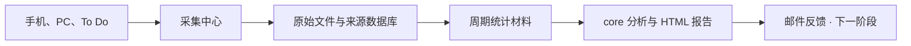

# Self Harness

Self Harness 是一个个人工作流反馈系统：持续记录睡眠、体重、任务完成和设备使用，把分散的数据整理为可比较的观察，通过报告和邮件帮助调整日常安排。

## 我们要做什么

围绕个人生活与工作的五类信息，回答四个问题：这段时间发生了什么、相比过去有什么变化、哪些观察值得关注、下一步可以尝试什么调整。

| 信息 | 观察内容 |
| --- | --- |
| 睡眠 | 睡眠长度、实际入睡与起床时段、睡眠分布 |
| 体重 | 体重范围、平均水平和变化 |
| 任务 | 完成内容、待办数量和任务变化 |
| iPhone 使用 | App 使用时长及分布 |
| PC 使用 | 应用、网站与页面活动，以及时间投入 |

## 工作流

手机端定时上传睡眠、体重和 App 使用数据，PC 采集 ActivityWatch，服务器定时获取 Microsoft To Do。数据汇集到采集中心，保留原始文件并转成结构化记录。

各来源的 operator 将细粒度记录整理为周期统计。分析环节读取这些材料，结合历史生成报告，再通过邮件投递反馈。

## 架构

项目按数据流划分职责，使用脚本、文件、SQLite 和系统定时任务组织自动运行。

| 部分 | 职责 |
| --- | --- |
| interface | 每个来源具有 fetcher、parser、database 和 operator，完成获取、转换、保存和统计 |
| observation | 汇集原始文件与结构化记录，提供统一的数据保存位置 |
| core | 读取周期材料，分析变化并生成报告 |
| email | 投递已保存的报告 |

各来源保留自己的数据结构，通过统一的查询与汇总入口提供材料。服务器、路径、来源地址、授权位置、时区与运行周期通过配置管理。

## 从一天看到一年

日报、周报、月报、季报、半年报和年报都包含五类信息。周期越长，材料越侧重走势、分布和上期变化。

日报和周报展示每日趋势，月报展示每周趋势，季度及以上展示每月趋势。屏幕活动把浏览器展开为网站，与其他应用一起表达时间投入。统计同时提供有效数据量，帮助理解结果的依据。

## 当前进展

已完成五个来源的采集、原始文件归档、结构化入库和多周期 operator，并部署了自动采集与入库任务。固定版本为 `operators-v0.1.0`。

已在本地实现 core 单次报告生成：读取 interface 周期材料，经 DeepSeek 分析后渲染并保存 HTML 报告。服务器运行副本尚未更新；下一阶段接入 Google OAuth 邮件投递。

## 开始使用与参与

- [安装和配置](.codex/operations/setup.md)
- [查询与生成统计材料](.codex/operations/cli.md)
- [开发工作流](.codex/workflows/development.md)
- [技术资源索引](.codex/README.md)
